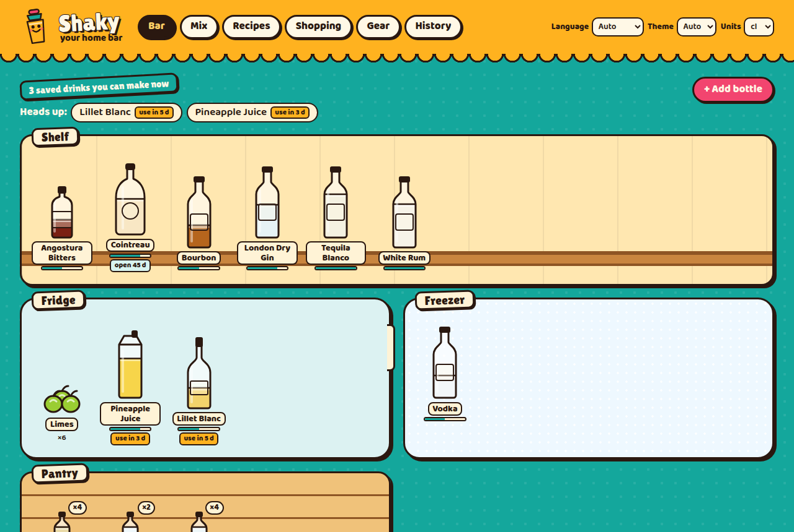
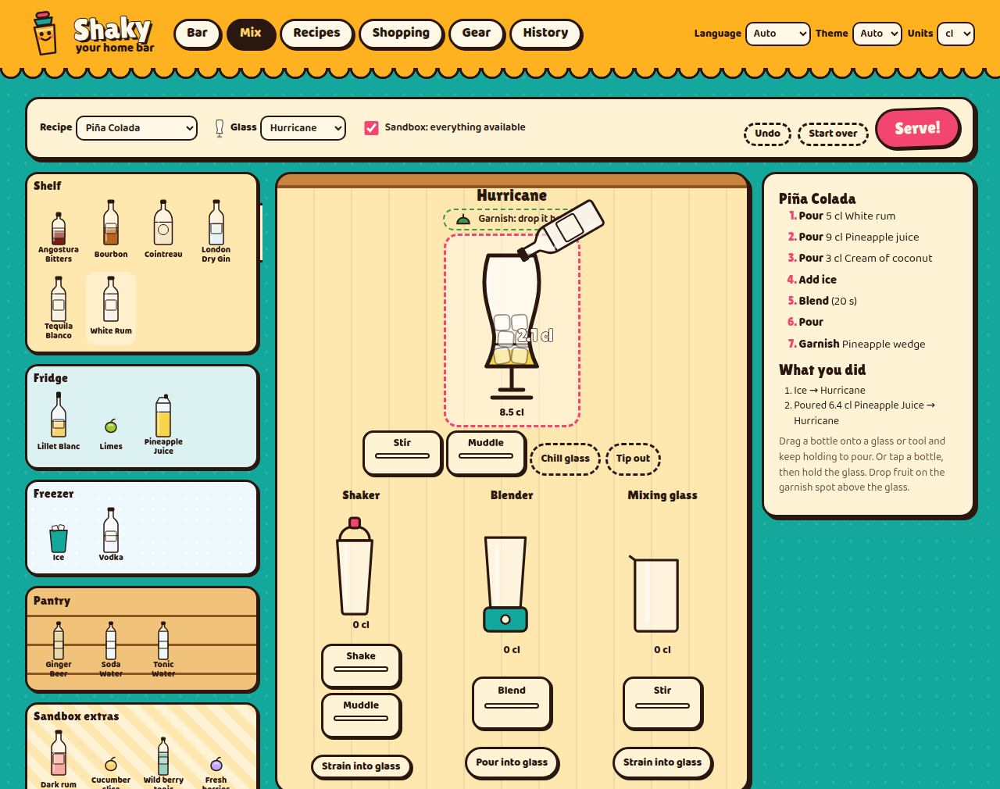
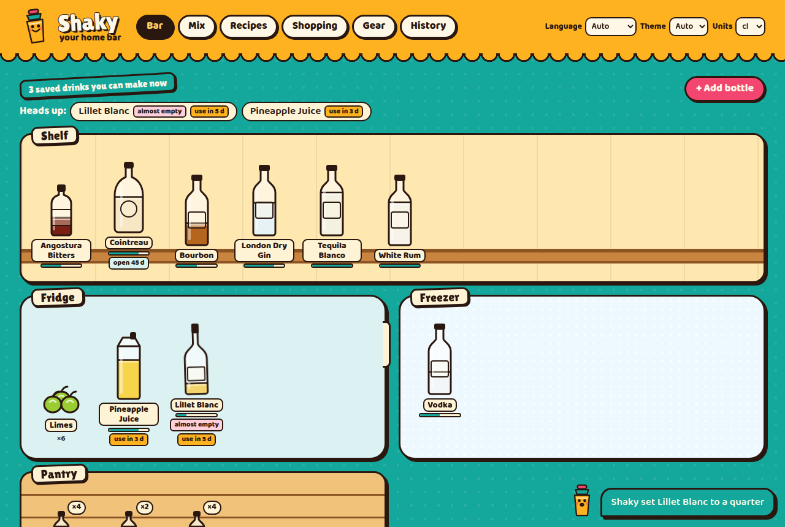
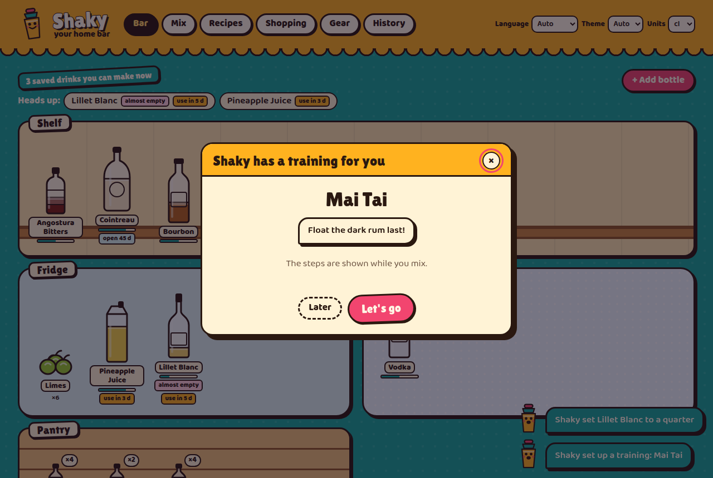

# Shaky

**Your local AI bartender.** Shaky is an MCP server that knows exactly what is in your home bar: spirits, liqueurs, syrups, juices, fruit, garnishes, equipment and glasses. Your AI (Claude Desktop, for example) already knows thousands of recipes. Shaky gives it the missing piece, a reliable picture of what you actually have, so it can suggest drinks you can make right now, offer substitutes, help you use up the open Lillet before it turns, keep your shopping list and even coach you at the bar.

Next to the MCP server runs a playful web UI on `localhost`: your bar as a comic tiki scene, a drag-and-drop mixing game, and a step-by-step mode for mixing for real. You and the AI write to the same database, and changes show up on both sides instantly.



> **Local only, no authentication.** Shaky binds to `127.0.0.1` and is meant to run on your own computer.
>
> **For adults of legal drinking age.** Please drink responsibly.

## Features

**For the AI (MCP)**

- **A bar inventory that stays true**: fill levels (full, three quarters, half, quarter, almost empty, empty) or exact ml, bottle counts, opened date and shelf life with editable defaults per category (an open vermouth or Lillet keeps about five weeks in the fridge, fresh juice a few days, spirits practically forever).
- **Fuzzy recipe matching**: "rum" matches any rum, "dark rum" never matches your white rum. Empty and expired bottles do not count. Find what you can make now (and how many times your stock allows it) and what misses just one ingredient. Items can say what they provide (limes: lime juice, zest, wedge), recipe lines can be `exact` or `exclude` words, so tonic water never takes the wild berry tonic.
- **Your taste**: "0.5 cl less lemon juice in sours", "no tequila". Recipes stay as saved; Shaky shows, deducts and scores your version and leaves avoided drinks out of suggestions.
- **Strength per drink**: ABV including melt water, standard drinks, and a warning for energy drink mixes.
- **Homemade syrups**: make simple syrup 1:1, rich syrup 2:1 or honey syrup from the sugar or honey in stock; the new bottle's shelf life starts today.
- **Batch calculator**: scale a drink to N glasses, respect a slush machine's minimum and maximum fill, and get a warning with a top-up amount when the batch is too strong to freeze.
- **Stand-ins**: rules like "ginger ale for ginger beer, milder" or "lemon for lime juice" make a recipe "makeable with a stand-in" instead of "one missing".
- **Use it up**: drinks that use bottles expiring soon come first.
- **Cost per drink** from the bottle prices you enter.
- **Alcohol free**: a filter for mocktails, plus five examples in `examples/mocktails.json`.
- **Party mode**: pick drinks for N guests and get amounts, what to buy, the ice you need and when to start freezing it, the cost, and a printable drinks menu. Guest diets are data (vegan: aquafaba instead of egg white; nut allergy: no orgeat).
- **Safety net**: every change can be undone (a whole "Mixed it!" at once), deleted things wait 30 days in the trash, and every changing tool has a dry run.
- **More ways for the AI to help**: check any drink it knows against your bar without saving it, find recipes by ingredient, say which bottle to buy next, pick a surprise drink, remember how you liked a drink, show your habits and spend, restock from the shopping list in one step, and open a recipe or the step-by-step view in your browser.
- **Photo of a label**: send it to Claude and it fills in brand, kind, ABV and size (prompt `add_bottle_from_photo`).
- **Log a drink, deduct the stock**: exact for bottles with ml, estimated from the fill level otherwise, limes via juice per piece. When a bottle runs out and you have a spare, the next one is opened.
- **Trainings**: the AI loads a recipe into the mixing game, you mix it, the server scores amounts, order, technique and garnish, and the AI reads the result to coach you.
- **Data driven**: equipment (with substitutes like "a jam jar can replace a shaker" and household stand-ins like a spoon for the bar spoon), glasses, storage locations and category defaults are data the AI can change through tools. No code changes needed.
- **Set up fast**: `add_ingredients` stocks a whole bar in one call, `update_recipe` changes single lines, `remove_example_data` clears the example bar.
- **Every change is logged** with its source: you in the web UI, the AI over MCP, or the command line.

**For you (web UI on localhost)**

- **Bar**: shelf, fridge, freezer and pantry as a scene. Every item has a container separate from its liquid: square, flat or bulbous bottles, syrup bottles with pourer, dropper bottles, cans in three sizes (counted and open or closed, no fill level), tetra paks, PET bottles, freezer bags, jars and packs, fruit drawn piece by piece. Variants (Red Bull Original / Sugarfree) live under one entry. Badges for "open 45 d", "use in 5 d", best before and "almost empty".
- **Mix (the game)**: drag bottles onto a glass, shaker, blender or mixing glass and hold to pour with a live cl counter; ice from the freezer, squeeze limes, shake with a shake meter, blend, stir, muddle, strain and garnish, and watch the glass fill in layers of the real colors. Only what you own shows up, unless you switch on the sandbox. Follow a recipe and get a score when you serve.
- **Mix for real**: one big step at a time for the kitchen counter, with servings, timers and a screen that stays awake; at the end the drink is logged and the stock updated.
- **Recipes** with filters and an editor for ingredients and structured steps, **shopping list**, **equipment and glasses**, **history** of every change, **backup** export and import.
- **Live updates**: when the AI changes something, a speech bubble tells you ("Shaky set Lillet Blanc to a quarter") and the bottle wobbles.
- English and German, light and dark mode, works on a phone.

| Mix                              | Live update from the AI                          | Training                                   |
| -------------------------------- | ------------------------------------------------ | ------------------------------------------ |
|  |  |  |

## Requirements

- Node.js **22.12 or newer** (24 LTS recommended)
- Windows, macOS or Linux. No database server, no Docker, no C++ compiler. SQLite ships with the package as a prebuilt binary for all three systems (the repo's `.npmrc` turns off install scripts so npm never tries to compile it).

## Installation

```bash
git clone https://github.com/akquisio-dev/Shaky-mcp.git
cd Shaky-mcp
npm install
npm run build
npm run seed      # optional: loads an example bar and twelve recipes
npm run doctor    # checks the setup and prints your Claude Desktop config
```

Your data lives outside the repository in a per-user folder (override with `SHAKY_DATA_DIR`):

| System  | Database location                                  |
| ------- | -------------------------------------------------- |
| Windows | `%APPDATA%\shaky\shaky.db`                         |
| macOS   | `~/Library/Application Support/shaky/shaky.db`     |
| Linux   | `$XDG_DATA_HOME/shaky/shaky.db` (`~/.local/share`) |

To update later: `git pull`, `npm install`, `npm run build`. Database migrations run automatically.

## Running

There are two ways to start Shaky. Both use the same database, so you can mix them.

| Command                     | What it does                                                                                                                                                                                              |
| --------------------------- | --------------------------------------------------------------------------------------------------------------------------------------------------------------------------------------------------------- |
| `node dist/cli.js mcp`      | MCP over **stdio**. This is what Claude Desktop starts. If port 8787 is free it also starts the web UI, so after opening Claude Desktop you can visit http://localhost:8787. Disable with `--no-web`.     |
| `npm start` (`shaky serve`) | Web UI, REST API and MCP over **Streamable HTTP** at `http://localhost:8787/mcp`.                                                                                                                         |
| `npm run seed`              | Loads `examples/seed.json`. Existing items are kept; `node dist/cli.js seed --reset` wipes the bar first.                                                                                                 |
| `node dist/cli.js export`   | Writes the whole bar as JSON (`export my-bar.json`) or CSV (`export --csv ingredients bar.csv`, `--csv recipes`). `import` reads either; `--replace` replaces the bar, `--dry-run` only shows the result. |
| `npm run doctor`            | Checks Node, database and port, and prints a ready-to-paste Claude Desktop config.                                                                                                                        |

Settings (environment variable or flag):

| Variable              | Flag         | Default         |
| --------------------- | ------------ | --------------- |
| `SHAKY_HOST`          | `--host`     | `127.0.0.1`     |
| `SHAKY_PORT`          | `--port`     | `8787`          |
| `SHAKY_DATA_DIR`      | `--data-dir` | per-user folder |
| `SHAKY_WEB_AUTOSTART` | `--no-web`   | `true`          |

## Claude Desktop

The easiest way is `npm run doctor`: it prints the exact snippet with the absolute paths for your machine. Open the config file (Claude Desktop: Settings, Developer, Edit Config), merge the `shaky` entry into `mcpServers` and restart Claude Desktop.

Using the absolute path of `node` avoids PATH problems with apps started from the dock or start menu (`which node` on macOS/Linux, `where node` on Windows).

**macOS** (`~/Library/Application Support/Claude/claude_desktop_config.json`)

```json
{
  "mcpServers": {
    "shaky": {
      "command": "/usr/local/bin/node",
      "args": ["/Users/you/Shaky-mcp/dist/cli.js", "mcp"]
    }
  }
}
```

**Windows** (`%APPDATA%\Claude\claude_desktop_config.json`, note the doubled backslashes)

```json
{
  "mcpServers": {
    "shaky": {
      "command": "C:\\Program Files\\nodejs\\node.exe",
      "args": ["C:\\Users\\you\\Shaky-mcp\\dist\\cli.js", "mcp"]
    }
  }
}
```

**Linux** (`~/.config/Claude/claude_desktop_config.json`, for community builds of Claude Desktop or any other MCP client)

```json
{
  "mcpServers": {
    "shaky": {
      "command": "/usr/bin/node",
      "args": ["/home/you/Shaky-mcp/dist/cli.js", "mcp"]
    }
  }
}
```

Then ask Claude something like _"What can I mix tonight, something fruity?"_ or _"I just finished the Lillet."_ Clients that speak Streamable HTTP can use `http://localhost:8787/mcp` while `shaky serve` runs.

Then ask Claude something like _"What can I mix tonight, something fruity?"_, _"I just finished the Lillet."_ or _"Train me on a Mai Tai."_

## MCP interface

**Tools**

| Area        | Tools                                                                                                                                                   |
| ----------- | ------------------------------------------------------------------------------------------------------------------------------------------------------- |
| Overview    | `get_bar_overview` (call first), `get_expiring`, `get_recent_activity`                                                                                  |
| Ingredients | `list_ingredients`, `get_ingredient`, `add_ingredient`, `add_ingredients`, `update_ingredient`, `archive_ingredient`, `set_fill_level`, `mark_opened`   |
| Bar setup   | `list_equipment`, `set_equipment`, `list_glassware`, `set_glassware`, `set_location`, `set_category_defaults`, `update_settings`, `remove_example_data` |
| Recipes     | `list_recipes`, `get_recipe`, `save_recipe`, `update_recipe`, `delete_recipe`, `find_makeable_recipes`, `log_mix`, `batch_calculator`                   |
| Taste       | `list_preferences`, `add_preference`, `remove_preference`, `list_substitutions`, `add_substitution`, `remove_substitution`                              |
| Homemade    | `list_preparations`, `make_preparation`, `save_preparation`                                                                                             |
| Party       | `plan_party`, `party_shopping`, `list_diets`, `add_diet_rule`, `remove_diet_rule`                                                                       |
| Shopping    | `shopping_list_get`, `shopping_list_add`, `shopping_list_update`                                                                                        |
| Training    | `start_training`, `get_training_result`, `cancel_training`                                                                                              |
| Safety net  | `undo`, `list_undoable`, `trash`; every changing tool also takes `dry_run: true`                                                                        |

**Resources**: `shaky://bar/overview`, `shaky://inventory`, `shaky://equipment`.

**Prompts**: `suggest_drink` (mood, taste), `use_up_leftovers`, `plan_a_party`, `add_bottle_from_photo`, `unify_language`.

Every tool answers with a short readable line plus compact JSON. Tools that change something list exactly what changed. `get_training_result` reports a training as pending until it is handed in, so the AI never has to guess a score.

## How a training works

1. The AI calls `start_training` with a saved recipe, an optional tip, and whether steps are shown or the user mixes from memory.
2. An open browser tab shows "Shaky has a training for you" right away (or on the next page load).
3. You mix it in the game and hand it in. The browser sends only the list of actions (what was poured where, how long you shook).
4. The server replays that list with the same game engine and scores it: amounts 45, order 25, technique 20, garnish 10 points, minus points for things that do not belong or spill. Real bottles are mapped to recipe lines with the same matching as the inventory.
5. The AI reads score, poured vs expected amounts and coaching lines with `get_training_result`.

## Security

Shaky has **no authentication**. That is fine on your own computer because it only listens on `127.0.0.1` and only answers requests whose `Host` and `Origin` point to localhost (this blocks DNS rebinding and other websites in your browser writing to your bar). Do not bind it to a public interface. To use it on a remote machine, tunnel it over SSH, see [docs/development.md](docs/development.md).

## Tech choices

- **Node.js + TypeScript (ESM)** and the official [MCP TypeScript SDK](https://github.com/modelcontextprotocol/typescript-sdk) with zod schemas shared by MCP tools, REST API and web client.
- **SQLite via better-sqlite3**: stable, synchronous (simple transactions), and since v13 the package ships prebuilt binaries for Windows, macOS and Linux (x64 and arm64), so `npm install` needs no compiler. The built-in `node:sqlite` is not yet marked stable in Node 22/24. WAL mode lets the stdio process and the web server share the file; migrations are versioned and checksummed.
- **Hono** for the HTTP server: small, built-in Server-Sent Events, and the MCP SDK's web-standard transport plugs straight into a route.
- **Vite + plain TypeScript** for the UI, no framework.
- **The game is DOM/SVG with pointer events, not a canvas engine** like PixiJS or Phaser. The bottles and glasses are the same hand-drawn SVG as in the bar view, it stays keyboard accessible, and the bundle stays small (about 90 kB of JavaScript, 30 kB gzipped). The rules live in `src/game`, a pure module without DOM: the browser runs it for the scene and the server replays the same actions to score trainings, so a canvas renderer could replace the scene later without touching the rules.
- **Vitest**, **ESLint**, **Prettier**, GitHub Actions on Ubuntu, Windows and macOS with Node 22 and 24.

## Contributing

See [CONTRIBUTING.md](CONTRIBUTING.md) and [docs/development.md](docs/development.md). Changes are listed in [CHANGELOG.md](CHANGELOG.md).

## License

[MIT](LICENSE) © akquisio-dev
